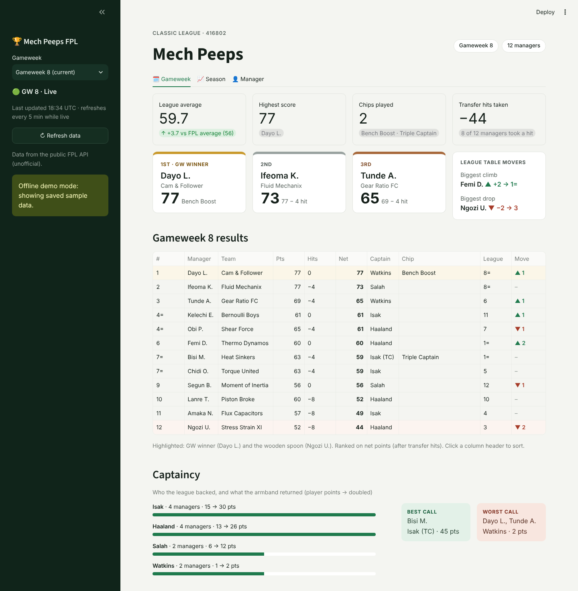
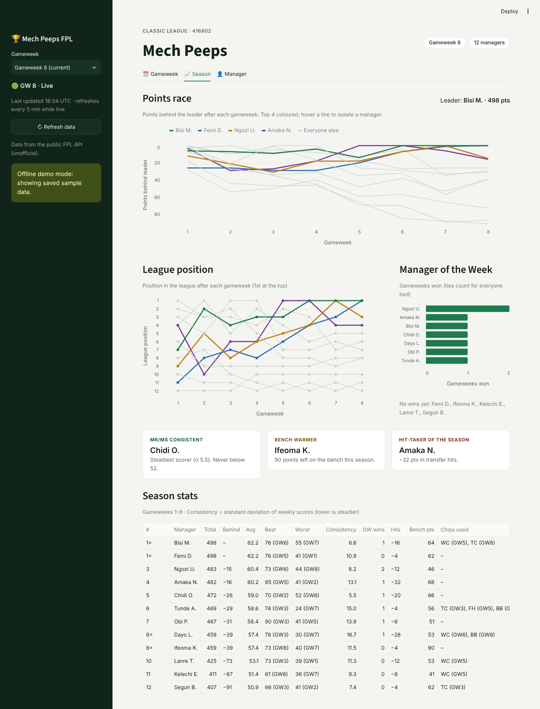
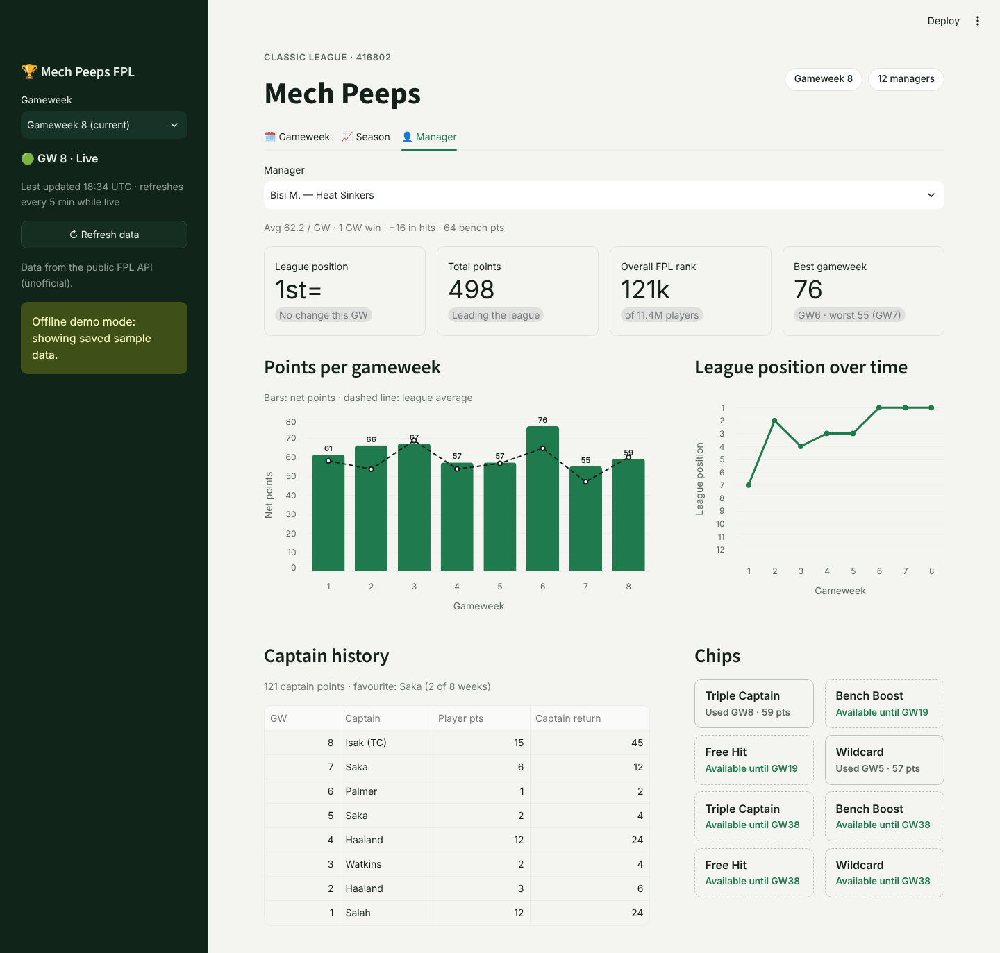

# 🏆 Mech Peeps FPL Dashboard

A Streamlit dashboard for the **Mech Peeps** Fantasy Premier League mini-league (league `416802`):
weekly results, the season-long race, and a page for every manager.

| Gameweek | Season | Manager |
|---|---|---|
|  |  |  |

*Screenshots use the made-up sample data in `sample_data/`.*

## What's in it

**🗓️ Gameweek**: league average vs the FPL average, highest score, chips played, transfer hits;
a gold/silver/bronze podium; biggest climber and faller; the full results table (net of hits, with
captain, chip, league position and movement); captaincy with each captain's return and the best/worst call.

**📈 Season**: points race (points behind the leader), league-position chart, Manager of the Week
tally, fun awards (most consistent, bench warmer, hit-taker), and a season stats table.

**👤 Manager**: any manager's position, total, overall rank and best week; points per GW vs the
league average; position over time; captain history; chips used and still available.

Rankings follow FPL's convention: ties share a place and the next is skipped (61, 61, 60 → 4=, 4=, 6).
Every ranking uses **net points** (after transfer hits).

## Run it locally

```bash
pip install -r requirements.txt
streamlit run fpl_dashboard.py
```

No FPL login is needed. The app reads the public FPL API.

**Offline demo** (no internet needed, made-up league):

```bash
python scripts/make_sample_data.py
FPL_FIXTURES_DIR=sample_data streamlit run fpl_dashboard.py
```

## League ID

The app is set up for Mech Peeps (`416802`). To point it elsewhere, use either of these:

- `.streamlit/secrets.toml` → `LEAGUE_ID = "123456"` (see `secrets.toml.example`), or
- environment variable `FPL_LEAGUE_ID=123456`.

Your league ID is the number in the league's URL on the FPL site:
`fantasy.premierleague.com/leagues/416802/standings/c`.

## Deploy (Streamlit Community Cloud, free)

1. Push this repo to GitHub.
2. Go to [share.streamlit.io](https://share.streamlit.io) → **Create app** → pick this repo and branch.
3. Main file: `fpl_dashboard.py`. Under *Advanced settings*, choose Python 3.12.
4. Deploy. If the repo already had an app deployed, it redeploys automatically on push.

Free apps sleep after a period of no visitors. The first visitor after that waits for it to wake up.
A `Dockerfile` is included, so the app can move to Cloud Run or Render later without code changes.

## How it works

```
fpl_dashboard.py      Streamlit entry: sidebar, header, tabs
fpl/api.py            FPL API client: retries, timeouts, pagination, concurrent fetches
fpl/data.py           Cached loaders (5 min while a GW is live, 24 h for finished GWs)
fpl/metrics.py        All calculations as pure pandas functions (unit-tested)
fpl/charts.py         Altair charts
fpl/views/            One module per tab
scripts/              Sample-data generator
tests/                pytest suite (no network needed)
```

- **One request per manager for the whole season** (`/entry/{id}/history/`) gives points, hits,
  bench points, ranks and chips for every gameweek.
- Captains come from `/entry/{id}/event/{gw}/picks/` (selected GW only), and their returns from
  `/event/{gw}/live/`. If a captain blanks in a finished GW, the vice-captain's return is shown.
- Requests run 8 at a time, with automatic retries on rate limits and server errors.
- **↻ Refresh data** in the sidebar clears the cache.

## Tests

```bash
pip install -r requirements-dev.txt
ruff check .
pytest
```

CI runs both on every push (`.github/workflows/ci.yml`).

## Notes

This uses the **unofficial** public FPL API, which can change between seasons. If something breaks
at the start of a season, check the field names in `fpl/api.py` and `fpl/metrics.py`.
The API also returns 503 while FPL updates between gameweeks. The app shows a "try again" message when that happens.
